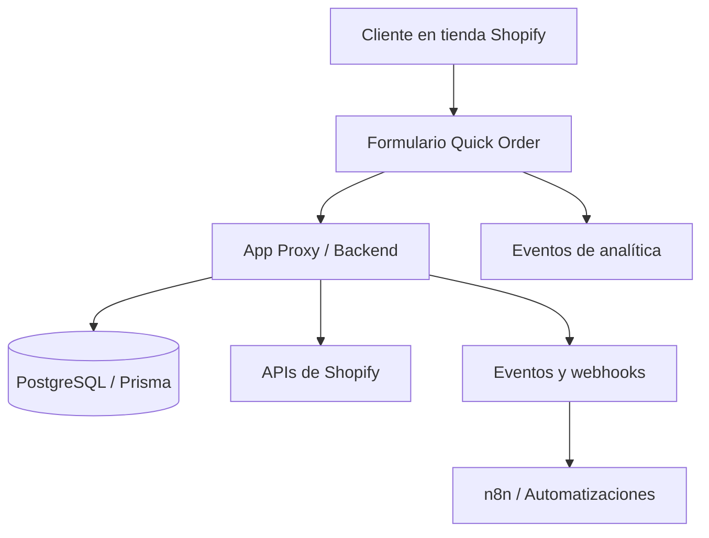

# Quick Order para Shopify

**Caso de estudio técnico · Aplicación privada de e-commerce**

Aplicación para Shopify enfocada en simplificar la compra y dar a las tiendas mayor control sobre sus formularios, ofertas y flujos de conversión, especialmente en operaciones que trabajan con **pago contraentrega (COD)**.

> **Nota:** Este repositorio documenta el proyecto como portafolio. El código fuente, las configuraciones y los datos operativos permanecen en repositorios privados.

## El problema

En operaciones de e-commerce, un checkout genérico no siempre se adapta a la forma de vender: ofertas por cantidad, formularios configurables, compra contraentrega, medición de eventos y automatización posterior a la intención de compra.

**Quick Order** reúne estas necesidades en una solución integrada con Shopify.

## Qué construí

- **Constructor visual de formularios:** edición de estructura, bloques, propiedades y apariencia.
- **Ofertas por cantidad:** múltiples opciones de compra con imágenes, precios, beneficios y selección predeterminada.
- **Checkout COD:** captura de datos, validaciones y creación de pedidos bajo un flujo de pago contraentrega.
- **Experiencia de compra configurable:** formularios, componentes y widget flotante integrados al storefront.
- **Medición de conversiones:** eventos de Meta Pixel, parámetros UTM y señales de intención de compra.
- **Recuperación y automatización:** captura de intenciones, detección de abandono y webhooks para sistemas externos.
- **Integración operativa:** conexión con flujos posteriores de mensajería y automatización mediante n8n.

Las funciones de checkout online se integran respetando los flujos correspondientes de Shopify.

## Stack tecnológico

| Capa | Tecnologías |
| --- | --- |
| Aplicación | React Router, JavaScript/TypeScript |
| Datos | Prisma, PostgreSQL |
| Shopify | App Proxy, Theme App Extension, APIs y eventos |
| Integraciones | Webhooks, Meta Pixel, n8n |
| Infraestructura | Linux, VPS, Docker |

## Arquitectura general

*Diagrama conceptual de alto nivel; omite deliberadamente detalles internos de implementación.*

## Flujo simplificado de un pedido contraentrega

1. El cliente abre el formulario desde la tienda.
2. Selecciona una oferta y completa sus datos.
3. El sistema valida la información y procesa la solicitud.
4. Se registra el pedido confirmado mediante la integración con Shopify.
5. Los eventos y webhooks permiten continuar con los procesos operativos.

## Desafíos técnicos

**Consistencia de precios y ofertas.** Mantener alineados los importes presentados en el formulario y los datos que procesa el backend.

**Idempotencia y control de duplicados.** Diseñar flujos que reduzcan el riesgo de registrar acciones repetidas ante reintentos.

**Integración de COD sin pasarela tradicional.** Adaptar el proceso de compra a un modelo contraentrega y sus necesidades operativas.

**Seguridad de integraciones.** Proteger información sensible y revisar riesgos asociados con solicitudes externas y webhooks.

**Paridad entre editor y tienda.** Lograr que la experiencia configurada en el constructor se refleje de forma consistente en el storefront.

## Desarrollo asistido por IA

Utilicé **OpenCode, Codex y Claude Code** como parte de un flujo de orquestación de agentes de IA para explorar implementaciones, generar cambios, depurar, revisar y mejorar componentes. Las decisiones de arquitectura, integración y validación forman parte del proceso de ingeniería; no atribuyo funcionalidades individuales a una herramienta específica.

## Capturas del proyecto

Las capturas se añadirán tras revisar que no incluyan datos de clientes ni información sensible.

| Vista | Estado |
| --- | --- |
| Constructor visual | Pendiente |
| Ofertas por cantidad | Pendiente |
| Checkout contraentrega | Pendiente |
| Widget flotante | Pendiente |
| Carritos abandonados | Pendiente |
| Webhooks y automatizaciones | Pendiente |

## Relación con otros sistemas

Quick Order para Shopify forma parte de una operación de e-commerce más amplia junto con un **plugin de Quick Order para WooCommerce** y una **plataforma administrativa en Laravel** para centralizar pedidos, logística, mensajería e integraciones. El código de estos sistemas permanece privado.

## Alcance de este repositorio

Este repositorio es una **presentación pública del proyecto**, no un paquete instalable ni una distribución open source. No incluye instrucciones de despliegue interno, variables de entorno, secretos, datos de clientes o código propietario.

---

**Desarrollado por [Cristian Andrés Loaiza Flórez](https://github.com/Cristian9518)** · [LinkedIn](https://linkedin.com/in/cristian-loaiza-florez-64ba83246)
